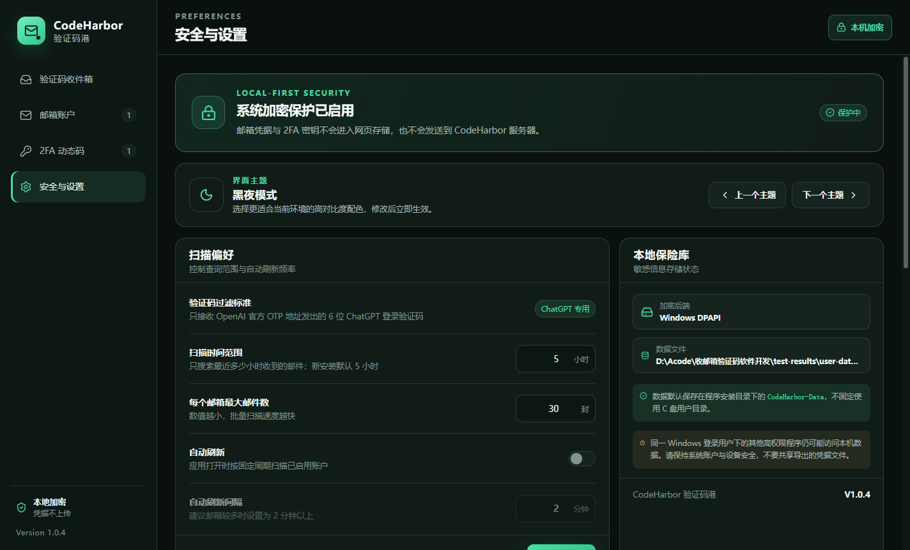

<p align="center">
  
</p>

<h1 align="center">CodeHarbor 验证码港</h1>

<p align="center">本地优先的 ChatGPT 登录验证码收件箱与 TOTP 2FA 管理器</p>

<p align="center">
  <a href="https://github.com/PascalePaF/codeharbor/releases/latest"></a>
  <a href="https://github.com/PascalePaF/codeharbor/actions/workflows/ci.yml"></a>
  
  
</p>


> CodeHarbor 只适用于你本人拥有或已获明确授权管理的邮箱与 2FA 项目。项目不提供自动登录、账号轮换、绕过平台限额或规避服务条款的功能。

## 跨平台社区预览

Android、iPhone/iPad 和 macOS 客户端已同步到 `1.0.4` 社区预览，源码位于 [`apps/codeharbor_flutter`](apps/codeharbor_flutter)。它不是简单网页壳，而是包含本机加密保险库、ChatGPT OTP 专用只读 IMAP 扫描、验证器二维码导入、TOTP 和与 Windows V1.0.2 及以后版本兼容的 `.chbackup` 导入导出。

| 平台 | 当前状态 | 获取方式 |
| --- | --- | --- |
| Windows 10/11 x64 | V1.0.4 稳定版 | [Releases](https://github.com/PascalePaF/codeharbor/releases/latest) |
| Android | 社区 Debug APK，可安装测试 | Mobile CI / Community Preview Release artifact |
| iPhone / iPad | iOS Simulator 开发预览 | Mobile CI artifact；实体设备仍需 Apple 签名 |
| macOS | 未签名开发预览 | Mobile CI artifact；正式分发仍需签名与公证 |

本仓库会在 GitHub 云端自动完成 Android、iOS Simulator 和 macOS 编译，因此维护者不需要本地拥有 Mac 或手机模拟器。真机覆盖、Apple 签名、公证和各邮箱测试由社区协作完成。具体边界与参与方式见 [Android、iPhone 与 macOS 社区预览](docs/MOBILE_COMMUNITY_PREVIEW.md)。

## 核心能力

- 集中管理 163、126、QQ / Foxmail、Gmail、阿里个人、阿里企业、Microsoft Outlook / 365、Mail.com 和自定义 IMAP 邮箱。
- CSV / TXT 批量导入最多 500 个邮箱或 2FA 项目，并支持邮箱、2FA 各自独立的加密导入和加密导出。
- 三栏验证码工作台：左侧逐个查询邮箱，中间只显示 ChatGPT 登录验证码，右侧显示实时 TOTP。
- 自适应界面：桌面窗口在 760×560 到超宽屏之间自动调整字号、间距、侧栏和收件箱栏数，窄窗口不再依赖整页横向滚动。
- “立即扫描全部邮箱”以最多 3 个并发只读连接批量扫描；只接受 OpenAI 官方 OTP 地址发出的登录语境 6 位码，其他邮件全部忽略。
- Base32 密钥或完整 `otpauth://` 链接生成 TOTP，支持 SHA1 / SHA256 / SHA512、6 / 8 位及 15–120 秒周期。
- 支持验证器二维码导入：电脑上传图片，Android/iPhone 使用相机或图片；兼容标准 TOTP 和 Google Authenticator 批量迁移二维码。
- 邮箱凭据和 2FA 密钥由 Windows DPAPI 等系统安全存储加密；应用没有遥测、云同步或 CodeHarbor 后端。
- `.chbackup` 使用 scrypt 密码派生和 AES-256-GCM 认证加密，可在不同电脑之间迁移。
- 安装版从 GitHub Releases 自动检查和下载新版本，下载完成后自动更新并重新启动。
- 高对比度黑夜 / 白天主题、清晰中文字体、完整页面滚动和字段悬停帮助。

| 验证码工作台 | 邮箱账户 | 2FA 动态码 | 安全与设置 |
| --- | --- | --- | --- |
|  |  |  |  |

## 安装

请从 [最新 Release](https://github.com/PascalePaF/codeharbor/releases/latest) 下载：

- `CodeHarbor-Setup-1.0.4-x64.exe`：推荐的 Windows 安装版，支持以后直接在软件内部自动更新。
- `CodeHarbor-Portable-1.0.4-x64.exe`：免安装便携版；因没有安装上下文，不支持内部自动替换。
- `SHA256SUMS.txt`：安装包校验值。

V1.0.2 是自动更新功能的起点；已安装 V1.0.2 或 V1.0.3 的安装版可以在软件内升级到 V1.0.4。当前构建尚未使用商业代码签名证书，Windows SmartScreen 首次运行时可能显示提示。

默认数据位置：

- 安装版：安装目录下的 `CodeHarbor-Data`。
- 便携版：便携 EXE 同级的 `CodeHarbor-Data`。

卸载或更新安装版时会保留这个数据目录。仍建议定期导出密码加密备份。

## 快速开始

1. 在邮箱官网开启 IMAP，并生成该服务商要求的客户端授权码、应用专用密码或 OAuth2 访问令牌。
2. 在“邮箱账户”页面添加邮箱，先执行“测试”确认连接成功。
3. 在“验证码收件箱”左侧查询单个邮箱，或点击“立即扫描全部邮箱”；新安装默认只查最近 5 小时，并只显示 ChatGPT 登录 OTP。
4. 在“2FA 动态码”页面输入 Base32 密钥、粘贴 `otpauth://` 链接，或通过二维码图片/手机相机导入验证器项目。
5. 换电脑前，为邮箱或 2FA 单独导出加密备份，也可以在设置中导出全部数据。

完整格式见 [批量导入格式](docs/IMPORT_FORMATS.md)，服务商准备步骤见 [邮箱服务商指南](docs/PROVIDERS.md)。

## 邮箱认证说明

| 服务商 | IMAP 地址 | 应填写的凭据 | 重要说明 |
| --- | --- | --- | --- |
| 网易 163 | `imap.163.com:993` | 客户端授权码 | 先开启 IMAP/SMTP，不填网页登录密码 |
| 网易 126 | `imap.126.com:993` | 客户端授权码 | 先开启 IMAP/SMTP，不填网页登录密码 |
| QQ / Foxmail | `imap.qq.com:993` | IMAP 授权码 | 不填 QQ 登录密码 |
| Gmail | `imap.gmail.com:993` | 16 位应用专用密码，或 OAuth2 访问令牌 | Google 账户的 6 位 2FA 动态码不能用于 IMAP 登录 |
| 阿里个人邮箱 | `imap.aliyun.com:993` | 邮箱密码 | 适用于 `@aliyun.com` |
| 阿里企业邮箱 | `imap.qiye.aliyun.com:993` | 三方客户端安全密码 | 需管理员允许第三方客户端 |
| Outlook / Microsoft 365 | `outlook.office365.com:993` | OAuth2 访问令牌 | 当前版本接收已有令牌，不负责申请或刷新 |
| Mail.com | `imap.mail.com:993` | 应用密码或邮箱密码 | IMAP 可能仅向部分套餐开放 |

邮箱账户本身不需要再输入“邮箱 2FA 动态码”。2FA 用于在网页上确认登录；IMAP 客户端通常使用单独生成的授权码、应用专用密码或 OAuth2 令牌。

## 加密备份

- 导出时必须设置至少 8 个字符的独立安全密码，并再次确认。
- 每次导出都使用新的随机盐和随机 IV，通过 scrypt 派生 256 位密钥，再以 AES-256-GCM 加密并验证完整性。
- 密码不会保存；忘记密码后备份无法恢复。
- 导入时先验证密码和文件完整性，再在目标电脑上用该系统的安全存储重新加密。
- 可以导出全部数据，也可以只导出邮箱或只导出 2FA；导入时只合并所选范围。

## 安全边界

- Electron 渲染进程启用上下文隔离和沙箱，禁用 Node.js 集成，仅暴露最小化 IPC 接口。
- IMAP 强制 TLS 1.2 及以上并校验证书，以只读方式打开 `INBOX`，不会将邮件标记为已读。
- ChatGPT OTP 只接受 OpenAI 官方列出的 `noreply@tm.openai.com` 与 `otp@tm1.openai.com`，并且必须是登录语境中的 6 位码。
- 验证器二维码完全在本机解码，不上传、不写日志，导入预览不显示密钥。
- 单封邮件最多解析 1 MiB，并限制 MIME 嵌套与邮件头大小。
- 敏感字段不写入日志；仓库和发布包不包含真实账户、密钥或保险库文件。

系统安全存储无法防御同一系统用户下已经运行的恶意软件或管理员级攻击。验证码复制后可能进入 Windows 剪贴板历史。完整威胁模型见 [安全模型](docs/SECURITY_MODEL.md)，漏洞报告方式见 [SECURITY.md](SECURITY.md)。

## 本地开发

要求 Windows 10/11、Node.js 24+、npm 11+。

```powershell
npm ci
npm run dev
```

```powershell
npm run typecheck   # TypeScript 检查
npm test            # 单元测试
npm run smoke       # Electron 启动、交互和安全烟雾测试
npm run verify      # 类型检查 + 测试 + 应用构建
npm run dist        # Windows 安装版、便携版和更新清单
```

构建产物位于 `release/`。进程边界见 [架构说明](docs/ARCHITECTURE.md)。

跨平台客户端：

```powershell
cd apps/codeharbor_flutter
flutter pub get
flutter analyze
flutter test
flutter build apk --debug
```

iOS 与 macOS 的编译和模拟器烟雾测试由 GitHub Actions 的 macOS runner 完成；无需在 Windows 上安装 Apple 虚拟机。

## 已知限制

- 只扫描 `INBOX`，不遍历垃圾邮件、归档或自定义文件夹。
- 当前不内置 Google / Microsoft OAuth 授权页面和令牌刷新；需要填写现有访问令牌，Gmail 也可使用应用专用密码。
- 验证码收件箱当前固定为 ChatGPT 登录专用，不显示其他网站或服务的邮箱验证码。
- Google Authenticator 的多张迁移二维码需要逐张扫描；HOTP 当前不支持。
- 自动更新仅适用于 Windows 安装版；便携版需下载新文件。
- 安装包暂未使用商业代码签名证书。
- Android、iOS 与 macOS 当前为社区开发预览，尚未完成正式商店签名、Apple 公证和多型号真机覆盖。

## 项目管理与许可证

- [变更记录](CHANGELOG.md)
- [贡献说明](CONTRIBUTING.md)
- [安全策略](SECURITY.md)
- [V1.0.2 发布说明](docs/RELEASE_NOTES-v1.0.2.md)
- [V1.0.3 发布说明](docs/RELEASE_NOTES-v1.0.3.md)
- [V1.0.4 发布说明](docs/RELEASE_NOTES-v1.0.4.md)
- [跨平台社区预览与测试](docs/MOBILE_COMMUNITY_PREVIEW.md)

本仓库公开用于透明审查和版本发布，但当前并未授予复制、修改或再分发许可；详见 [LICENSE](LICENSE)。请勿在 Issue、日志或提交中包含真实密码、授权码、OAuth2 令牌、TOTP 密钥、验证码邮件原文或保险库文件。

## 独立实现与参考

CodeHarbor 参考了 [qlerky-tui](https://github.com/Aero25x/qlerky-tui) 的本地多账户左右分栏思路、[2fast](https://github.com/2fast-team/2fast) 的单文件加密备份体验，以及 [authenticator-sh/2fa](https://github.com/authenticator-sh/2fa) 的密码保护导入导出边界。项目没有复制或打包这些项目的源码；邮箱会话、验证码筛选、界面、数据模型、加密备份和 TOTP 均为本仓库的 TypeScript 独立实现。
