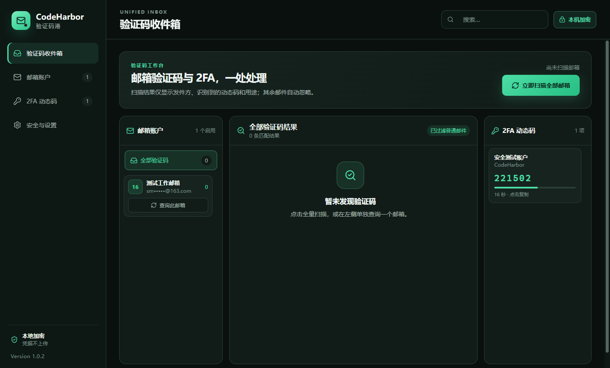
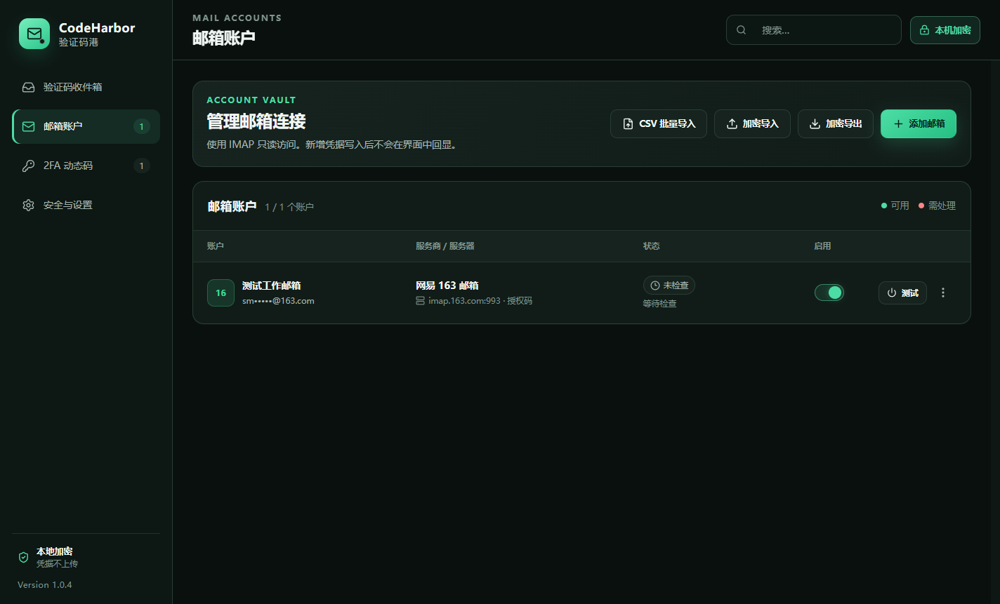
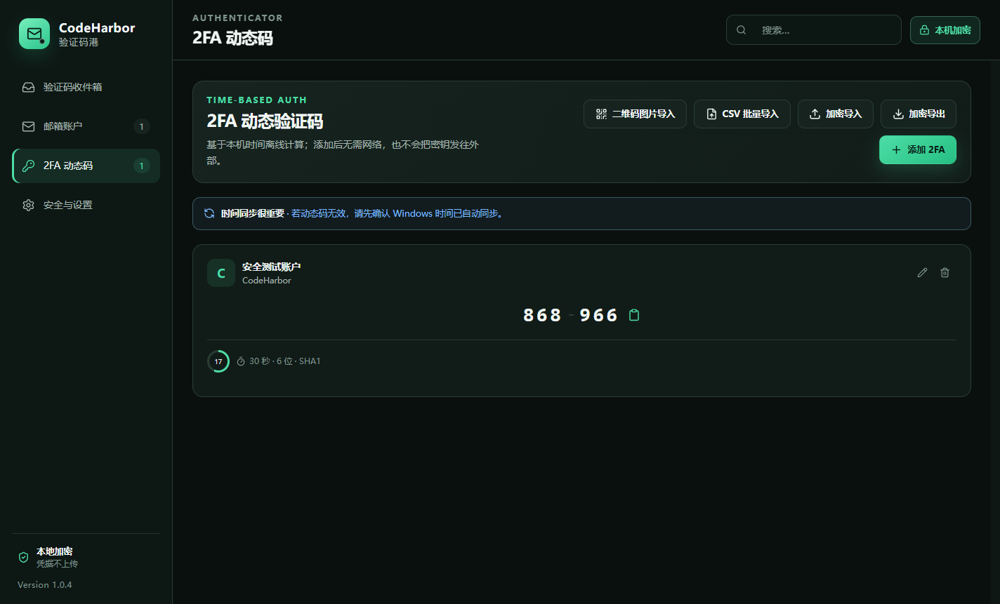

<p align="center">
  
</p>

<h1 align="center">CodeHarbor 验证码港</h1>

<p align="center">
  本地优先的 Windows 多邮箱验证码收件箱与 TOTP 2FA 管理器
</p>

<p align="center">
  <code>V1.0.1</code> · <code>Windows x64</code> · <code>只读 IMAP</code> · <code>本机加密</code> · <code>加密迁移</code>
</p>



> 仅用于你本人拥有或明确获授权管理的邮箱与账户。CodeHarbor 不提供自动登录、账号轮换、绕过平台限额或规避服务条款的功能。

## V1.0.1 功能

- 批量导入最多 500 个邮箱账户，支持 CSV、TXT 和 `邮箱----授权码` 简洁格式。
- 内置 163、126、QQ / Foxmail、Gmail、阿里个人、阿里企业、Microsoft Outlook / 365、Mail.com 预设。
- 支持自定义 IMAP 主机、端口、TLS 与登录用户名，覆盖企业邮箱和其他标准邮箱。
- 以只读模式并发扫描邮箱，不会把邮件标记为已读。
- 从主题及正文中提取 4–10 位数字或字母数字验证码，按相关度排序。
- 支持 Base32 密钥和 `otpauth://` 链接，可批量导入 TOTP。
- 支持 SHA1 / SHA256 / SHA512、6 / 8 位、15–120 秒周期。
- 邮箱凭据和 2FA 密钥使用操作系统安全存储加密后落盘。
- 可把全部邮箱、2FA 与设置导出为密码加密的 `.chbackup`，并在另一台电脑上合并恢复。
- 安装版数据位于安装目录的 `CodeHarbor-Data`；便携版数据位于便携 EXE 旁的同名目录。
- 支持手动扫描、连接测试、账户停用、扫描范围与自动刷新设置。
- 邮箱网络错误会留在账户状态中，不再变成 Electron 主进程崩溃弹窗。

| 验证码收件箱 | 邮箱账户 | 2FA 动态码 |
| --- | --- | --- |
|  |  |  |

## 安装与使用

从私有仓库的 Releases 页面下载以下任一文件：

- `CodeHarbor-Setup-1.0.1-x64.exe`：Windows 安装版。
- `CodeHarbor-Portable-1.0.1-x64.exe`：免安装便携版。

首次使用建议按以下顺序：

1. 在邮箱网页版开启 IMAP，并生成客户端授权码或应用专用密码。
2. 在“邮箱账户”中单个添加，或下载 CSV 模板后批量导入。
3. 先用“测试”确认连接，再到“验证码收件箱”执行扫描。
4. 在“2FA 动态码”中输入 Base32 密钥或粘贴 `otpauth://` 链接。
5. 需要换电脑时，在“安全与设置 → 跨电脑备份与恢复”导出完整加密备份，再在新电脑导入。

完整字段说明见 [批量导入格式](docs/IMPORT_FORMATS.md)，邮箱准备方式见 [服务商指南](docs/PROVIDERS.md)。

## 邮箱兼容性

| 服务商 | IMAP 地址 | 推荐认证方式 | 备注 |
| --- | --- | --- | --- |
| 网易 163 | `imap.163.com:993` | 客户端授权码 | 需先开启 IMAP/SMTP |
| 网易 126 | `imap.126.com:993` | 客户端授权码 | 需先开启 IMAP/SMTP |
| QQ / Foxmail | `imap.qq.com:993` | IMAP 授权码 | 不要使用 QQ 登录密码 |
| Gmail | `imap.gmail.com:993` | 16 位应用专用密码或 OAuth2 | 6 位 2FA 动态码不是 IMAP 密码 |
| 阿里个人邮箱 | `imap.aliyun.com:993` | 邮箱密码 | 适用于 `@aliyun.com` |
| 阿里企业邮箱 | `imap.qiye.aliyun.com:993` | 三方客户端安全密码 | 需管理员允许第三方客户端 |
| Outlook / Microsoft 365 | `outlook.office365.com:993` | OAuth2 访问令牌 | V1.0.1 接收已有令牌，但不负责申请或刷新 |
| Mail.com | `imap.mail.com:993` | 应用密码 / 邮箱密码 | IMAP 可能只对 Premium 套餐开放 |

V1.0.1 已验证协议实现、加密落盘、加密备份往返、错误密码与篡改拦截、TOTP 标准向量、邮箱失败恢复和桌面启动链路；仓库不会包含真实邮箱凭据，因此仍应由使用者用自己的测试邮箱验证服务商当前策略。

## 安全设计

- Windows 使用 DPAPI 保护敏感字段；macOS 使用 Keychain；Linux 需要可用的系统密钥环，否则应用会拒绝保存密钥。
- 渲染界面启用上下文隔离、沙箱、禁用 Node.js 集成，并通过最小化 IPC 接口访问主进程。
- IMAP 使用 TLS 1.2 或更高版本并严格校验证书；邮箱始终以只读锁打开。
- 邮件只截取最多 1 MiB 进行解析，并限制 MIME 嵌套深度和邮件头大小。
- 跨电脑备份使用 scrypt 派生独立密钥并以 AES-256-GCM 认证加密；错误密码或文件篡改会被拒绝。
- 没有遥测、云端同步或 CodeHarbor 后端；敏感字段不会写入日志。

系统加密不能防御同一 Windows 用户下运行的恶意软件或管理员级攻击；复制验证码后，系统剪贴板及剪贴板历史也可能保留内容。详细边界见 [安全模型](docs/SECURITY_MODEL.md)。

## 本地开发

要求：Windows 10/11、Node.js 24 或更高版本、npm 11 或更高版本。

```powershell
npm ci
npm run dev
```

常用命令：

```powershell
npm run typecheck   # TypeScript 检查
npm test            # 核心单元测试
npm run smoke       # 启动 Electron、验证加密 IPC 并截图
npm run verify      # 类型检查 + 测试 + 应用构建
npm run dist        # 生成 Windows 安装版和便携版
```

构建产物位于 `release/`。项目结构和进程边界见 [架构说明](docs/ARCHITECTURE.md)。

V1.0.1 官方构建的 SHA-256 见 [校验和文件](docs/CHECKSUMS-v1.0.1.txt)。

## 已知限制

- 当前只扫描 `INBOX`，不遍历垃圾邮件、归档或自定义文件夹。
- OAuth2 模式接收现有访问令牌，但 V1.0.1 尚未内置 Google / Microsoft 授权和令牌刷新流程。
- 验证码提取采用本地规则，复杂模板可能返回多个候选值；请结合发件人和主题确认。
- 安装版卸载时会保留安装目录中的 `CodeHarbor-Data`；仍建议在升级、移动或卸载前导出 `.chbackup`。
- Windows 构建尚未使用商业代码签名证书，首次下载时 SmartScreen 可能显示提示。

## 项目管理

- 变更记录：[CHANGELOG.md](CHANGELOG.md)
- 贡献说明：[CONTRIBUTING.md](CONTRIBUTING.md)
- 安全问题：[SECURITY.md](SECURITY.md)
- V1.0.1 发布检查：[docs/RELEASE_CHECKLIST.md](docs/RELEASE_CHECKLIST.md)

本仓库为私有项目，保留所有权利。禁止提交真实密码、授权码、OAuth2 令牌、2FA 密钥或真实邮箱导入文件。
